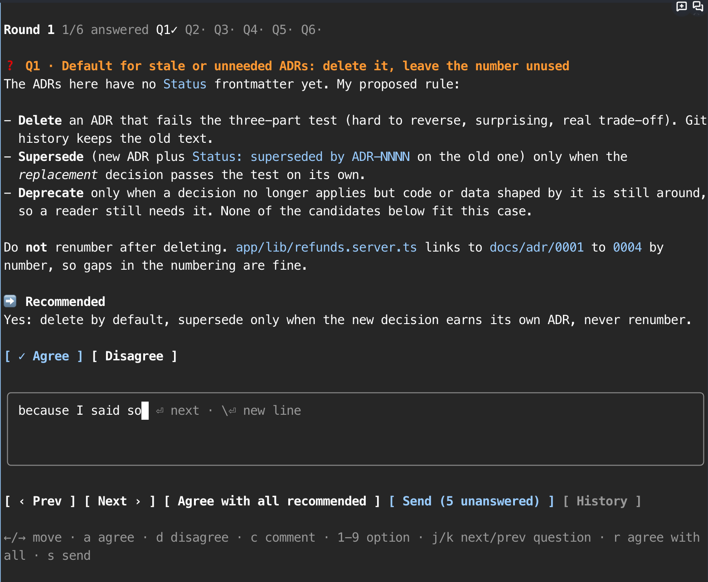

# roast

A Claude Code mod for Matt Pocock's grilling skills (`/grill-me`, `/grill-with-docs`) and `/wayfinder`. Instead of reading a wall of questions and typing your replies, you answer each round in a pane beside the chat, and roast sends your answers back to Claude for the next round.



## Using it

1. **Start a grilling session.** Run `/grill-me`, `/grill-with-docs` or `/wayfinder` as usual. When the skill loads, roast asks Claude to hand each round of questions to the pane instead of writing them in the chat. If Claude writes a round as text anyway, roast reads the `❓ **Q1**` / `➡️` format and opens the pane itself.
2. **Read the question.** The pane shows one question at a time: its title, Claude's explanation, and Claude's **Recommended** answer under ➡️. The top line shows the round number, how many questions you've answered, and a ✓ beside each answered question.
3. **Answer it.**
   - **Agree** takes Claude's recommendation. **Disagree** rejects it.
   - When the question lists choices, pick one with its number instead.
   - Type in the comment box to explain your answer or to give Claude more context. Claude gives your comment more weight than the button you picked. A comment alone is an answer when none of the buttons fit.
   - In the comment box, Enter moves on and `\` then Enter adds a new line.
4. **Move through the round.** **Prev** and **Next** step between questions. **Agree with all recommended** fills in every question you haven't touched, which is handy when you only want to push back on one or two.
5. **Send.** The **Send** button shows how many questions are still unanswered and won't send until there are none. Sending submits your answers as your next prompt, and Claude replies with the next round.
6. **Look back.** **History** lists every round of the session and what you answered. `/roast` reopens the pane if you closed it.

## Keys in the pane

| Key | Action |
| --- | --- |
| `a` / `d` | agree / disagree (questions without options) |
| `1`–`9` | pick an option |
| `c` | jump to the comment box |
| `j` / `k` | next / previous question |
| `r` | agree with all recommended |
| `s` | send the round |
| `h` | history |

Left and right arrows moving between buttons is a keybinding, not part of the mod. Add this to `~/.claude/keybindings.json`:

```json
{ "context": "Pane", "bindings": { "right": "abovePrompt:next", "left": "abovePrompt:previous", "up": null, "down": null } }
```

## Install

At the prompt of a Claude Code terminal session:

```
/plugin install roast --marketplace danielmackay/roast
```

Answer `y` to add the marketplace, then press Enter to install at the user scope.

From a shell:

```
claude plugin install roast --marketplace danielmackay/roast
```

In the desktop app, where `/plugin` does not run: click + next to the prompt box, then Plugins, Add marketplace with `danielmackay/roast`, then Add plugin.

Needs Matt Pocock's skills plugin for the grilling skills themselves.
